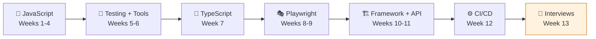
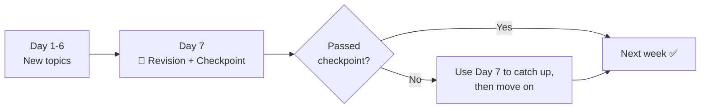
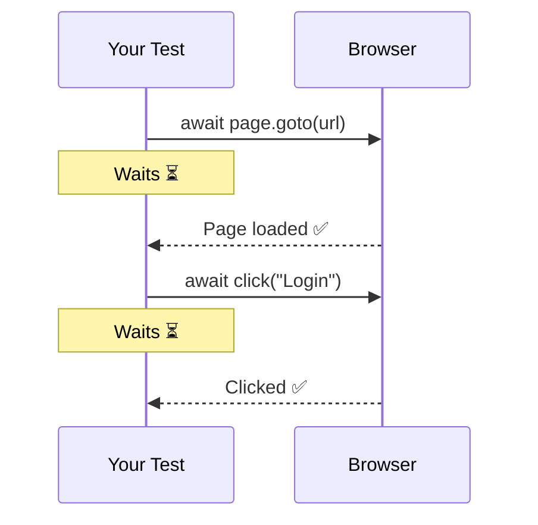
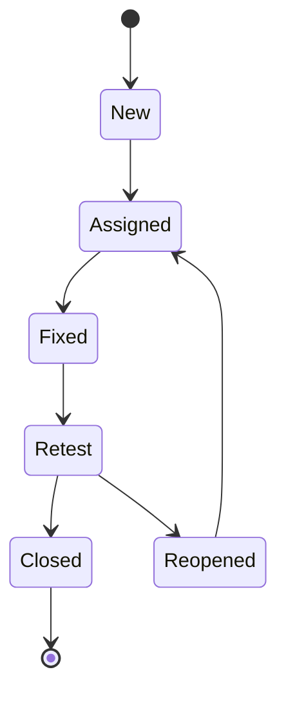
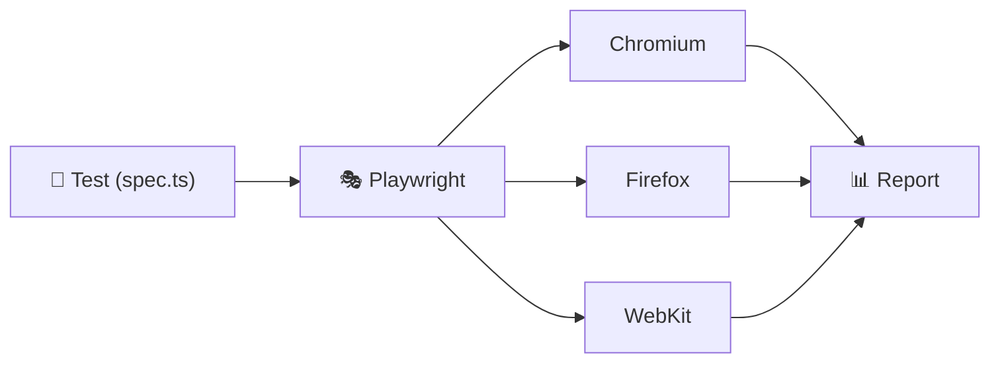
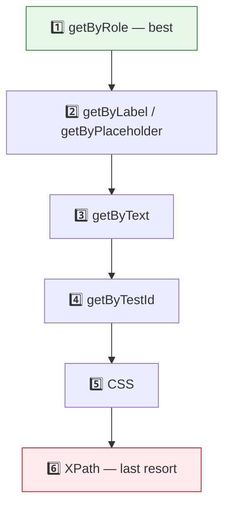
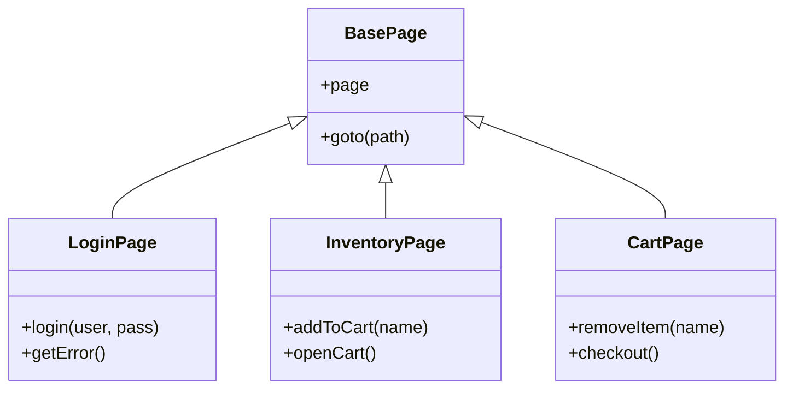
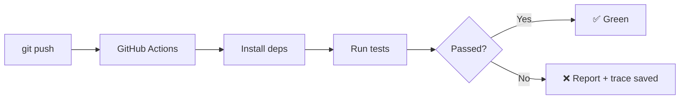
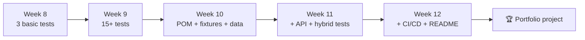
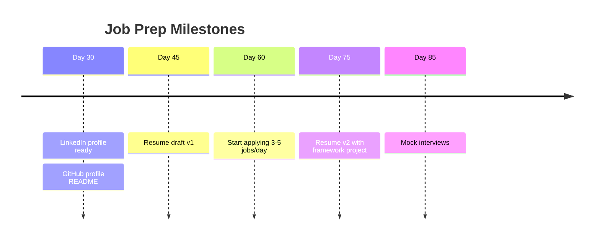

# 🎭 90-Day Playwright Roadmap (Zero → Job Ready)


> **Goal:** Go from zero coding to a junior QA Automation job in 90 days.
> **Rules:** 70% coding, 30% learning · Every 7th day = revision · No zero days.

---

## 🗺 The Plan at a Glance



| Week | Days | Focus |
|---|---|---|
| 1–4 | 1–28 | JavaScript foundations |
| 5 | 29–35 | Testing theory, HTML/DOM, Git, Jira |
| 6 | 36–42 | HTTP, Postman, SQL |
| 7 | 43–49 | TypeScript basics + Playwright setup |
| 8–9 | 50–63 | Playwright core + real-world scenarios |
| 10–11 | 64–77 | Page Object Model, fixtures, API testing |
| 12 | 78–84 | CI/CD, reports, portfolio polish |
| 13 | 85–90 | Interview prep + mock interviews |

---

## ⏰ Daily Routine (~1h 45m)

| Time | Activity |
|---|---|
| 15 min | 🧩 One small JS coding problem (from Week 2) |
| 15 min | 🔁 Revise yesterday's notes |
| 60 min | 📖 Learn new topic + code along |
| 15 min | 📝 Write notes + push to GitHub |

### Weekly rhythm



> 💡 **Fell behind?** Don't panic. Use Day 7 to catch up. Never skip a whole week.

---

## 📘 Weeks 1–4 — JavaScript Foundations

> Playwright tests ARE code. Strong JS basics = easy Playwright later.

### Week 1 — Basics (Days 1–7)

| Day | Topic |
|---|---|
| 1 | Install Node.js (LTS) + VS Code, run `node hello.js` |
| 2 | Variables (`let`, `const`), data types, `typeof` |
| 3 | Operators, `==` vs `===` |
| 4 | `if` / `else`, ternary |
| 5 | `switch`, logical operators (`&&`, `\|\|`, `!`) |
| 6 | Mini project: grade calculator |
| 7 | 🔁 **Revision + Checkpoint** |

✅ **Ready if you can:** write a program that takes a number and prints whether it's positive, negative, or zero, and even or odd.

### Week 2 — Loops & Functions (Days 8–14)

| Day | Topic |
|---|---|
| 8 | `for` loop |
| 9 | `while`, `break`, `continue` |
| 10 | Functions: parameters, `return` |
| 11 | Arrow functions, default parameters |
| 12 | Scope (global vs block) |
| 13 | Mini project: FizzBuzz + multiplication table |
| 14 | 🔁 **Revision + Checkpoint** |

✅ **Ready if you can:** write `isPrime(n)` and `sumOfArray(arr)` without help.

### Week 3 — Arrays, Objects, Strings (Days 15–21)

| Day | Topic |
|---|---|
| 15 | Arrays: `push`, `pop`, `slice`, `includes`, `indexOf` |
| 16 | `forEach`, `map`, `filter`, `find` |
| 17 | Objects: properties, nested objects |
| 18 | Array of objects (used a LOT in testing) |
| 19 | String methods: `split`, `trim`, `replace`, `toUpperCase` |
| 20 | Template literals, destructuring, spread |
| 21 | 🔁 **Revision + Checkpoint** |

✅ **Ready if you can:** from an array of users, return the names of everyone older than 25 living in Delhi.

### Week 4 — Modules, Classes, Async ⭐ (Days 22–28)

| Day | Topic |
|---|---|
| 22 | npm, `package.json`, `import` / `export` |
| 23 | Classes: `constructor`, methods, `this` |
| 24 | Class inheritance (`extends`, `super`) |
| 25 | Why async? Callbacks, `setTimeout` |
| 26 | Promises: `.then()`, `.catch()` |
| 27 | `async` / `await`, `try` / `catch`, `fetch` an API |
| 28 | 🔁 **Revision + Checkpoint** |

✅ **Ready if you can:** write an `async` function that fetches users from `jsonplaceholder.typicode.com/users` and prints only their emails.

### Why `await` matters in every test



> Forget `await` → the test runs ahead of the browser → random failures.

---

## 🧪 Week 5 — Testing Theory, Web & Git (Days 29–35)

| Day | Topic |
|---|---|
| 29 | SDLC, STLC, Agile/Scrum |
| 30 | Test cases & scenarios; smoke, sanity, regression, E2E |
| 31 | Bug reports, bug life cycle, severity vs priority |
| 32 | HTML basics + DOM + Chrome DevTools |
| 33 | Git: `add`, `commit`, `push`, `branch`, `pull`; Pull Requests |
| 34 | Jira basics: stories, bugs, sprints, boards |
| 35 | 🔁 **Revision + Checkpoint** |

✅ **Ready if you can:** write 10 test cases for a login page and log 2 bugs in proper format.



---

## 🌐 Week 6 — HTTP, Postman & SQL (Days 36–42)

| Day | Topic |
|---|---|
| 36 | HTTP: methods (GET/POST/PUT/DELETE), status codes, JSON |
| 37 | Postman: send requests, headers, body, auth token |
| 38 | Postman: collections, variables, simple tests |
| 39 | SQL: `SELECT`, `WHERE`, `ORDER BY` |
| 40 | SQL: `JOIN`, `GROUP BY`, `COUNT` |
| 41 | Practice: 15 SQL queries + full CRUD on restful-booker in Postman |
| 42 | 🔁 **Revision + Checkpoint** |

✅ **Ready if you can:** create, update, and delete a booking in Postman, and write a SQL query joining two tables.

---

## 🔷 Week 7 — TypeScript + Playwright Setup (Days 43–49)

| Day | Topic |
|---|---|
| 43 | TypeScript: why it exists, types, type errors |
| 44 | Interfaces, type aliases, optional properties |
| 45 | Classes in TypeScript, `public` / `private` / `readonly` |
| 46 | `async` functions with types, `tsconfig.json` |
| 47 | `npm init playwright@latest` (choose TypeScript), folder structure |
| 48 | Run tests: headed, headless, `--ui`, one file, one browser |
| 49 | 🔁 **Revision + Checkpoint** |

✅ **Ready if you can:** run the sample Playwright tests in UI mode and explain each line.

---

## 🎭 Weeks 8–9 — Playwright Core (Days 50–63)



### Week 8 — Basics (Days 50–56)

| Day | Topic |
|---|---|
| 50 | `playwright.config.ts`: `baseURL`, timeouts, browsers, retries |
| 51 | Locators: `getByRole`, `getByText`, `getByLabel`, `getByPlaceholder` |
| 52 | Locators: `getByTestId`, CSS, `filter`, `nth`, chaining |
| 53 | Actions: `click`, `fill`, `check`, `selectOption`, `press` |
| 54 | Assertions: `toBeVisible`, `toHaveText`, `toHaveURL`, `toHaveCount` |
| 55 | Auto-waiting, hooks (`beforeEach`), `test.describe` |
| 56 | 🔁 **Revision + Checkpoint** |

✅ **Ready if you can:** automate login → add item to cart → verify cart count on saucedemo.

### Locator priority



### First test

```typescript
// tests/login.spec.ts
import { test, expect } from '@playwright/test';

test('valid user can log in', async ({ page }) => {
  await page.goto('https://www.saucedemo.com/');
  await page.getByPlaceholder('Username').fill('standard_user');
  await page.getByPlaceholder('Password').fill('secret_sauce');
  await page.getByRole('button', { name: 'Login' }).click();

  await expect(page).toHaveURL(/inventory/);
  await expect(page.getByText('Products')).toBeVisible();
});
```

### Week 9 — Real-World Scenarios (Days 57–63)

| Day | Topic |
|---|---|
| 57 | Dropdowns, checkboxes, radio buttons |
| 58 | Alerts / dialogs, iframes (`frameLocator`) |
| 59 | New tabs & windows, file upload & download |
| 60 | Web tables, hover, drag-and-drop |
| 61 | Codegen, `--debug`, `page.pause()` |
| 62 | Trace Viewer, screenshots & videos on failure |
| 63 | 🔁 **Revision + Checkpoint** |

✅ **Ready if you can:** debug a failing test using Trace Viewer and explain why it failed.

---

## 🏗 Weeks 10–11 — Framework & API (Days 64–77)

### Week 10 — Page Object Model (Days 64–70)

| Day | Topic |
|---|---|
| 64 | Why POM? Create `LoginPage` |
| 65 | `InventoryPage`, `CartPage`, `CheckoutPage` |
| 66 | `BasePage` + inheritance |
| 67 | Custom fixtures to inject page objects |
| 68 | Test data in JSON + data-driven tests |
| 69 | `.env` files for different environments |
| 70 | 🔁 **Revision + Checkpoint** |

✅ **Ready if you can:** add a new page object and test in under 30 minutes.



```typescript
// pages/LoginPage.ts
import { Page, Locator } from '@playwright/test';

export class LoginPage {
  readonly username: Locator;
  readonly password: Locator;
  readonly loginButton: Locator;

  constructor(private page: Page) {
    this.username = page.getByPlaceholder('Username');
    this.password = page.getByPlaceholder('Password');
    this.loginButton = page.getByRole('button', { name: 'Login' });
  }

  async goto() {
    await this.page.goto('/');
  }

  async login(user: string, pass: string) {
    await this.username.fill(user);
    await this.password.fill(pass);
    await this.loginButton.click();
  }
}
```

### Week 11 — API Testing & Auth (Days 71–77)

| Day | Topic |
|---|---|
| 71 | Playwright `request`: GET + assertions |
| 72 | POST, PUT, DELETE with auth token (restful-booker) |
| 73 | Validate response body & status codes |
| 74 | Hybrid test: create data via API, verify in UI |
| 75 | Log in once with `storageState` |
| 76 | Tags (`@smoke`), `--grep`, parallel workers, retries |
| 77 | 🔁 **Revision + Checkpoint** |

✅ **Ready if you can:** run only `@smoke` tests and explain the difference between UI and API tests.

---

## ⚙️ Week 12 — CI/CD & Portfolio Polish (Days 78–84)

| Day | Topic |
|---|---|
| 78 | What is CI/CD? GitHub Actions basics |
| 79 | Run tests on every push + upload HTML report |
| 80 | Fix flaky tests, clean up code, ESLint + Prettier |
| 81 | Write a strong project README (setup, structure, how to run) |
| 82 | Build a small separate API test repo |
| 83 | Record a 2-minute demo video of your framework |
| 84 | 🔁 **Revision + Checkpoint** |



```yaml
# .github/workflows/playwright.yml
name: Playwright Tests
on: [push, pull_request]
jobs:
  test:
    runs-on: ubuntu-latest
    steps:
      - uses: actions/checkout@v4
      - uses: actions/setup-node@v4
        with:
          node-version: lts/*
      - run: npm ci
      - run: npx playwright install --with-deps
      - run: npx playwright test
      - uses: actions/upload-artifact@v4
        if: always()
        with:
          name: playwright-report
          path: playwright-report/
```

---

## 💼 Week 13 — Interview Prep (Days 85–90)

| Day | Topic |
|---|---|
| 85 | JavaScript & TypeScript interview questions |
| 86 | Testing theory + SQL questions |
| 87 | Playwright & framework questions |
| 88 | Live coding: write a test from scratch in 20 minutes |
| 89 | Mock interview (full round) |
| 90 | 🎉 Final review, keep applying daily |

---

## 🌱 One Project That Grows

Don't build scattered exercises. Build **one framework** that improves every week.



### Final structure

```
playwright-framework/
├── .github/workflows/playwright.yml
├── pages/
│   ├── BasePage.ts
│   ├── LoginPage.ts
│   ├── InventoryPage.ts
│   └── CartPage.ts
├── tests/
│   ├── ui/
│   └── api/
├── fixtures/
├── test-data/users.json
├── utils/
├── .env.example
├── playwright.config.ts
└── README.md
```

---

## 💼 Job Track (Runs Alongside Learning)



### Top interview topics

| Area | Must know |
|---|---|
| JavaScript | `let`/`const`/`var`, `==` vs `===`, Promises, `async`/`await`, array methods |
| Testing | STLC, severity vs priority, smoke vs sanity vs regression |
| SQL | `SELECT`, `WHERE`, `JOIN`, `GROUP BY` |
| API | Status codes, GET vs POST vs PUT, Postman |
| Playwright | Locators, auto-waiting, fixtures, frames/tabs, flaky tests |
| Framework | Explain your POM, test data, environments, CI |
| Comparison | Playwright vs Selenium vs Cypress |

---

## 🧩 Daily JS Problems (Weeks 2–13)

Reverse a string · Check palindrome · Find max in array · Count vowels · Remove duplicates · FizzBuzz · Factorial · Fibonacci · Find second largest · Count word frequency · Flatten an array · Check anagram · Capitalize each word · Sum of digits · Find missing number · Merge two arrays · Sort without `sort()` · Find duplicates · Character count in object · Swap two variables

---

## ⭐ Optional / Bonus Topics

Do these only if you're ahead of schedule:

- Docker (run tests in a container)
- Allure reports + GitHub Pages
- Visual testing (`toHaveScreenshot`)
- Network mocking (`page.route`)
- Sharding & mobile emulation
- Accessibility testing

---

## 🌐 Practice Websites

| Site | Use for |
|---|---|
| [saucedemo.com](https://www.saucedemo.com) | Main framework project |
| [the-internet.herokuapp.com](https://the-internet.herokuapp.com) | Alerts, frames, tabs, uploads, tables |
| [automationexercise.com](https://automationexercise.com) | Extra e-commerce practice |
| [restful-booker.herokuapp.com](https://restful-booker.herokuapp.com) | API testing |
| [jsonplaceholder.typicode.com](https://jsonplaceholder.typicode.com) | JS fetch practice |

## 📚 Resources

| Topic | Resource |
|---|---|
| JavaScript | [javascript.info](https://javascript.info) |
| TypeScript | [typescriptlang.org/docs](https://www.typescriptlang.org/docs/) |
| Playwright | [playwright.dev](https://playwright.dev) |
| Git | [learngitbranching.js.org](https://learngitbranching.js.org) |
| SQL | [sqlbolt.com](https://sqlbolt.com) |

---

## ✅ Progress Tracker

- [ ] Week 1 — JS basics
- [ ] Week 2 — Loops & functions
- [ ] Week 3 — Arrays, objects, strings
- [ ] Week 4 — Modules, classes, async
- [ ] Week 5 — Testing theory, HTML, Git, Jira
- [ ] Week 6 — HTTP, Postman, SQL
- [ ] Week 7 — TypeScript + Playwright setup
- [ ] Week 8 — Playwright basics
- [ ] Week 9 — Real-world scenarios + debugging
- [ ] Week 10 — Page Object Model
- [ ] Week 11 — API testing & auth
- [ ] Week 12 — CI/CD & portfolio
- [ ] Week 13 — Interview prep
- [ ] 🎯 LinkedIn ready (Day 30)
- [ ] 🎯 Resume v1 (Day 45)
- [ ] 🎯 Started applying (Day 60)

---

## 💡 Golden Rules

1. **No zero days** — even 30 minutes counts.
2. **Type code yourself** — no copy-paste while learning.
3. **Push to GitHub daily.**
4. **Stuck for 30+ minutes?** Ask for help, then move on.
5. **Behind schedule?** Use Day 7. Don't quit.

<p align="center"><b>Day 1 starts now. 🎭</b></p>
