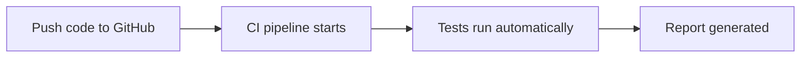
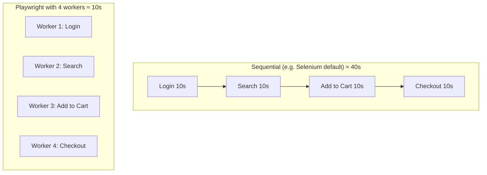

# 📘 Playwright with JavaScript #01 — Introduction to Playwright

## 🎯 What you'll learn
- What Playwright is and why it's popular
- Key features of Playwright
- How parallel testing saves time
- Playwright vs Selenium vs Cypress
- When to choose which tool

---

## 1️⃣ What is Playwright?

> **Playwright** is an **open-source test automation framework** developed by **Microsoft** for testing modern web applications.

| Point | Detail |
|---|---|
| Type | Open-source test automation framework |
| Created by | Microsoft |
| Used for | Web testing, API testing, mobile web testing |
| Browsers | Chromium (Chrome, Edge), Firefox, WebKit (Safari engine) |
| Languages | JavaScript, TypeScript, Python, Java, .NET (C#) |
| OS | Windows, macOS, Linux |
| CI tools | GitHub Actions, Jenkins, GitLab CI, Azure DevOps |

---

## 2️⃣ Key Features

### 🌐 Cross-browser testing
Run the **same test** on Chromium, Firefox, and WebKit to check browser compatibility.

### 🗣 Multi-language support
Write tests in JavaScript, TypeScript, Python, Java, or C#. The same APIs are available in every language, which makes team collaboration easy.

### 💻 Cross-platform
Runs on Windows, Mac, Linux, local machines, cloud servers, and CI pipelines.

### ⚡ Easy setup
One command downloads browsers, creates the config file, and adds sample tests. A project is ready in about 5 minutes.

### 🧪 Multiple testing types in one tool
| Type | What it tests | Example |
|---|---|---|
| Functional / E2E | User flows | Login, add to cart, submit a form |
| API | Backend responses | GET/POST requests, status codes |
| Accessibility | Usability for people with disabilities | Screen-reader labels, roles (with axe-core) |
| Mobile web | Websites in mobile browsers (emulated) | Site on iPhone/Pixel viewport |

> ⚠️ **Mobile web testing ≠ mobile app testing.** Playwright tests websites in mobile browsers, not native Android/iOS apps.

### 📊 Built-in reporters
- Built-in: **HTML, List, Line, Dot, JSON, JUnit**
- The HTML report shows steps, errors, and screenshots of failures
- **Custom reporters** let teams create their own report format

### 🔄 CI/CD support
**CI/CD = Continuous Integration / Continuous Delivery (Deployment)**


No need to run tests manually after every change.

### 🐳 Docker support
Solves the **"works on my machine"** problem.

| Without Docker | With Docker |
|---|---|
| Different browser, OS, and Node versions on each laptop | Fixed browser, OS, Node, and Playwright versions in a container |
| Test passes for me, fails for you | Same results everywhere (local + CI) |
| Random failures | Predictable, stable tests |

---

## 3️⃣ Built-in Tools

| Tool | What it does |
|---|---|
| 🎥 **Codegen** | Records your browser actions (click, type, navigate) and **auto-generates test code** with good locators |
| 🔍 **Playwright Inspector** | Runs tests **step by step**, lets you pause/resume, and helps pick locators |
| 🧭 **Trace Viewer** | After a run, shows a full **timeline**: each action, DOM snapshots, screenshots, console, and network logs to find the **root cause** of failures |
| 🎯 **Locator picker** | Suggests the best locator (role, text, test ID) for an element |

```bash
npx playwright codegen https://example.com   # record actions → code
npx playwright test --debug                  # open Playwright Inspector
npx playwright show-trace trace.zip          # open Trace Viewer
```

> 💡 Codegen is great for learning and getting locators, but always **clean up and refactor** generated code before using it.

---

## 4️⃣ Auto-Waiting

Playwright **automatically waits** for elements to be ready (visible, enabled, stable) before acting on them.

- ✅ No need to write manual waits
- ✅ Fewer **flaky tests** (tests that randomly pass/fail)
- ✅ Works well with modern apps (React, Angular, Vue) where pages keep re-rendering

---

## 5️⃣ Parallel Testing

Playwright runs tests **at the same time** using **workers** (parallel processes).



**Real-world example:**
| | Sequential | Parallel (6 workers) |
|---|---|---|
| 300 tests × 2 sec | ~600 sec (10 min) | ~100 sec (~1.5 min) |

> Same tests, same code → much faster execution.

---

## 6️⃣ Playwright vs Selenium vs Cypress

| Feature | 🎭 Playwright | 🌐 Selenium | 🌲 Cypress |
|---|---|---|---|
| Speed | ⚡ Very fast | Slower (older architecture) | Fast |
| Auto-waiting | ✅ Built-in | ❌ Mostly manual waits | ✅ Built-in |
| Browsers | Chromium, Firefox, WebKit | Widest support (most mature) | Chromium-based best, limited others |
| Languages | JS, TS, Python, Java, C# | Java, Python, C#, Ruby, JS | JavaScript / TypeScript only |
| Testing types | Web + API + mobile web | Mainly web | Mainly web (frontend) |
| Modern frameworks | ✅ Smooth | Needs extra waits/retries | ✅ Very friendly |
| Setup | Easy, built-in test runner | Drivers + third-party tools | Easy, single command |
| Debugging | Trace Viewer, Inspector, video | Relies on third-party tools | Excellent, in-browser |
| Multi-tab / multi-user | ✅ Yes, in one test | ✅ Tabs supported | ❌ No multi-tab |
| Parallel execution | ✅ Built-in, free | Needs Grid / TestNG setup | Limited / paid dashboard |
| Community | Newer, growing fast | Largest, most mature | Strong, JS-focused |

---

## 7️⃣ When to Use Which Tool

| Choose | When |
|---|---|
| 🎭 **Playwright** | Starting fresh, modern apps (React/Angular/Vue), need web + API + mobile web testing, fast & stable tests, cross-browser, parallel runs, strong debugging |
| 🌐 **Selenium** | Large enterprise/legacy projects already built on Selenium, need very old browser support, mature ecosystem |
| 🌲 **Cypress** | Frontend-heavy apps, developers and testers share the same JS codebase, component testing, mainly Chrome-based testing |

---

## 🎤 Interview Questions from This Video

1. **What is Playwright?** → An open-source test automation framework by Microsoft for modern web apps.
2. **Which browsers does Playwright support?** → Chromium (Chrome, Edge), Firefox, WebKit (Safari engine).
3. **Which languages does Playwright support?** → JavaScript, TypeScript, Python, Java, .NET (C#).
4. **What types of testing can you do with Playwright?** → Functional/E2E, API, accessibility, mobile web.
5. **Can Playwright test native mobile apps?** → No. It tests websites in mobile browsers (emulation), not native apps.
6. **What is auto-waiting?** → Playwright waits for elements to be ready before acting, which reduces flaky tests.
7. **What are workers in Playwright?** → Parallel processes that run tests at the same time.
8. **What is Codegen?** → A tool that records browser actions and generates test code.
9. **Difference between Inspector and Trace Viewer?** → Inspector debugs **live** step by step; Trace Viewer analyzes a **completed** run in detail.
10. **How does Docker help in testing?** → Gives the same environment everywhere and solves "works on my machine".
11. **Playwright vs Selenium — key differences?** → Playwright is faster, has auto-waiting, a built-in runner, parallel runs, API testing, and better debugging tools. Selenium has wider language/browser support and a bigger community.
12. **Why not Cypress?** → JS/TS only, no multi-tab support, limited multi-browser support.

---

## ✅ Practice Task
- [ ] Write in your own words: what is Playwright and why is it popular?
- [ ] List 5 key features of Playwright from memory
- [ ] Draw (or explain) how parallel testing saves time
- [ ] Explain the Playwright vs Selenium vs Cypress difference in 1 minute, out loud
- [ ] Add these notes to your README under "Session 1"

# 📘 Playwright with JavaScript #02 — Environment Setup

## 🎯 What you'll learn
- Install **Node.js** and **VS Code**
- Create a project folder
- Install Playwright (2 ways: **Terminal** and **VS Code extension**)
- Understand the project folder structure
- Run tests (headless & headed) and open the **HTML report**

---

## 1️⃣ Install Node.js

**Why?** Playwright runs on Node.js, so it's required.

**Steps (Windows):**
1. Go to the official site → [nodejs.org](https://nodejs.org) → Download page
2. Download the **Windows Installer (.msi)** — choose the **LTS** version
3. Double-click → accept license → Next → Next → Install → Finish
4. Default install location: `C:\Program Files\nodejs`

**Verify installation** (open Command Prompt):
```bash
node -v    # shows Node.js version
npm -v     # shows npm version
```

> 💡 **npm** (Node Package Manager) is installed automatically with Node.js. No separate install needed.

---

## 2️⃣ Install VS Code

**Why VS Code?**
| Benefit | Explanation |
|---|---|
| ⚡ Lightweight & fast | Won't slow down your laptop |
| 🟨 JavaScript-friendly | Great support for JavaScript & TypeScript |
| 💡 Auto-suggestions | Makes writing code faster and easier |
| 🧩 Extensions | Playwright, Git, Python and more |
| 🖥 Built-in terminal | No need to open Command Prompt separately |
| 🐞 Easy debugging | Find and fix errors quickly |
| 💸 Free & popular | Used by most developers |

**Steps:**
1. Go to [code.visualstudio.com](https://code.visualstudio.com) → Download
2. Choose your OS (Windows / Mac / Linux)
3. Run the setup → accept license → ✅ tick **"Create a desktop icon"** → Next → Install → Finish

---

## 3️⃣ Create a Project Folder

1. Create a folder anywhere, e.g. `PlaywrightAutomation` on Desktop
2. Open it in VS Code:
   - **File → Open Folder** → select the folder, **or**
   - **Drag and drop** the folder into VS Code
3. Click **"Yes, I trust the authors"** when asked

---

## 4️⃣ Install Playwright

### Method A: Terminal ⭐ (industry standard, asked in interviews)

Open the terminal in VS Code: **View → Terminal** (shortcut: `` Ctrl + ` ``)

```bash
npm init playwright@latest
```

> 💡 `@latest` installs the newest version. For a specific version, replace `latest` with a version number.

**Setup questions:**
| Question | Answer |
|---|---|
| TypeScript or JavaScript? | **JavaScript** (use ↑ ↓ arrow keys, then Enter) |
| Where to put your end-to-end tests? | `tests` (default → press Enter) |
| Add a GitHub Actions workflow? | **true** (Yes) |
| Install Playwright browsers? | **true** (Yes) |

> If you skipped browser install, run it later with: `npx playwright install`

### Method B: VS Code Extension (beginner-friendly)

1. Open a new empty project folder in VS Code
2. Open Extensions: **View → Extensions** or `Ctrl + Shift + X`
3. Search **"Playwright Test for VSCode"** (by Microsoft) → **Install**
4. Configure it: open Command Palette → **View → Command Palette** or `Ctrl + Shift + P`
5. Search **"Install Playwright"** → select it
6. ✅ Select **"Use JavaScript"** (TypeScript is selected by default!)
7. Keep **Chromium, Firefox, WebKit** selected → **OK**

> ⚠️ Installing the extension alone is not enough. You must also **configure** it (steps 4–7).

| | Terminal | VS Code Extension |
|---|---|---|
| Used in industry | ⭐ Most common | Less common |
| Asked in interviews | ✅ Yes | Rarely |
| Beginner-friendly | Good | Easiest |

---

## 5️⃣ Project Folder Structure

```
PlaywrightAutomation/
├── node_modules/          # All installed libraries — never edit manually
├── tests/
│   └── example.spec.js    # Sample test file with 2 demo tests
├── playwright.config.js   # ⭐ Main config file for the whole project
├── package.json           # ⭐ Project "ID card": name, version, dependencies
├── package-lock.json      # Locks exact package versions — don't edit
└── .gitignore             # Files NOT to upload to GitHub
```

| File / Folder | Purpose |
|---|---|
| `node_modules/` | Stores all Playwright & npm packages. Auto-created. **Never edit.** |
| `tests/` | All your test files go here |
| `example.spec.js` | Sample script showing basic format (opening a web page) |
| `playwright.config.js` | Browsers (Chromium, Firefox, WebKit), headless on/off, base URL, screenshots, videos, timeouts. **All project-wide settings.** |
| `package.json` | Project name, version, installed packages. npm uses it to manage the project. |
| `package-lock.json` | Makes sure every computer uses the **same package versions** (no version mismatch) |
| `.gitignore` | Keeps heavy/unwanted files (`node_modules`, screenshots, videos, logs) out of GitHub |

> ⭐ Most important: `playwright.config.js`, `package.json`, and the `tests/` folder

---

## 6️⃣ Run Tests

| Command | What it does |
|---|---|
| `npx playwright test` | Runs **all** tests in the `tests/` folder in **headless** mode (no browser window) |
| `npx playwright test --headed` | Runs tests in **headed** mode (you can see browsers open & close) |

**Why does it run tests from the `tests/` folder?**
Because `playwright.config.js` has:
```javascript
testDir: './tests',
```

### Understanding the output
```
Running 6 tests using 4 workers
6 passed
```
- `example.spec.js` has **2 tests**
- Config has **3 browsers** (Chromium, Firefox, WebKit)
- **2 tests × 3 browsers = 6 tests**
- **Workers** = how many tests run in parallel at the same time

| Mode | Browser visible? | Speed | Used for |
|---|---|---|---|
| Headless (default) | ❌ No | Faster | CI/CD, daily runs |
| Headed (`--headed`) | ✅ Yes | Slower | Learning, watching, debugging |

---

## 7️⃣ Open the HTML Report

A report is generated automatically after every run.

```bash
npx playwright show-report
```

- Opens at `http://localhost:9323`
- Shows tests per browser (Chromium / Firefox / WebKit)
- Shows **passed, failed, flaky, skipped** counts and **total time**

---

## 📝 Quick Command Cheat Sheet

```bash
node -v                          # Check Node.js version
npm -v                           # Check npm version
npm init playwright@latest       # Install Playwright in project
npx playwright install           # Install browsers (if skipped)
npx playwright test              # Run all tests (headless)
npx playwright test --headed     # Run all tests (browser visible)
npx playwright show-report       # Open last HTML report
```

---

## 🎤 Interview Questions from This Video

1. **Why do we need Node.js for Playwright?** → Playwright runs on Node.js.
2. **What is npm?** → Node Package Manager, installed with Node.js, used to install and manage packages.
3. **How do you install Playwright?** → `npm init playwright@latest`
4. **What is the use of `playwright.config.js`?** → Project-wide settings: browsers, headless mode, base URL, timeouts, screenshots, videos.
5. **Difference between `package.json` and `package-lock.json`?** → `package.json` lists project info and dependencies; `package-lock.json` locks exact versions so every machine uses the same ones.
6. **What is headless mode?** → Running tests without showing the browser window. It's the default.
7. **How do you run tests in headed mode?** → `npx playwright test --headed`
8. **Why did 2 tests show as 6?** → Each test runs on 3 browsers.
9. **How do you open the HTML report?** → `npx playwright show-report`

---

## ✅ Practice Task
- [ ] Install Node.js and verify with `node -v` and `npm -v`
- [ ] Install VS Code + Playwright extension
- [ ] Create a project and install Playwright via terminal
- [ ] Run tests in headless mode
- [ ] Run tests in headed mode
- [ ] Open the HTML report and check results for each browser
- [ ] Push the project to GitHub (check that `node_modules` is NOT uploaded)
